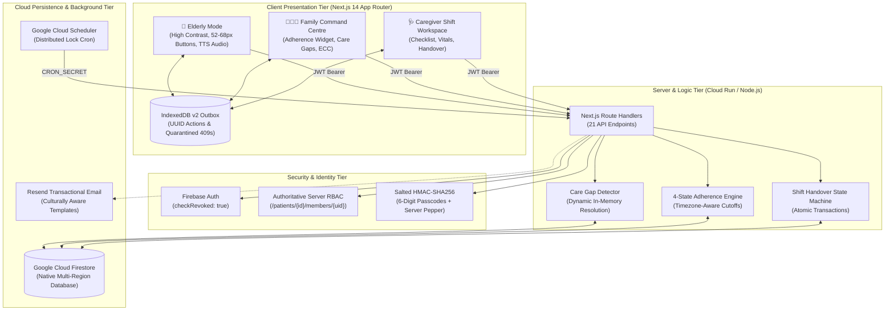

# JEEVASETU (जीवसेतु) — Beyond Medication Reminders

> **"A bridge between generations."**  
> An accountable, human-centered elderly-care coordination platform connecting elderly individuals, family members, and professional caregivers in a single trustworthy ecosystem.

[](https://www.typescriptlang.org/)
[-black.svg)](https://nextjs.org/)
[](https://firebase.google.com/)
[](https://cloud.google.com/)
[](https://vitest.dev/)
[-success.svg)](https://www.w3.org/WAI/standards-guidelines/wcag/)

---

## 1. Problem Statement & The JEEVASETU Solution

Conventional medication reminder applications assume that an alert is sufficient to ensure an elderly person receives care. In the real world, alerts are ignored, silenced, or dismissed without medication being taken. Crucially, when an elder falls ill or misses doses, families and doctors are left with the same unanswered questions:
- *Who was responsible during this shift?*
- *Did the elder physically take the medicine, or was the alert simply marked done?*
- *Why was a dose skipped? Was it dizziness, nausea, or physician advice?*
- *Did the outgoing caregiver hand over unfinished care tasks before departing?*

**JEEVASETU focuses on what happens around care:**
- **Accountability Over Reminders:** Every action has an attributed actor, verified role, and cryptographic audit trail.
- **4-State Certainty:** Doses are never assumed taken. States progress strictly from `UNCONFIRMED` ➔ `TAKEN` | `SKIPPED` (with mandatory explanation) | `MISSED`.
- **Duty Continuity:** Caregiver shift handovers require mandatory two-party acknowledgment before shift responsibility transfers.
- **Proactive Intelligence:** Real-time Care Gap Detection identifies unconfirmed doses (>60m), unattended clinic visits (<48h), and unacknowledged handovers (>2h) before harm occurs.
- **Offline-First Resilience:** Client-side UUID outbox ensures care is documented at the bedside without network access, syncing idempotently upon reconnect with 409 conflict quarantine.

---

## 2. Platform Architecture



---

## 3. Three Distinct Role-Tailored Experiences

JEEVASETU provides three specialized modes without ever compromising server-side security:

```
┌───────────────────────────────────────┬───────────────────────────────────────┬───────────────────────────────────────┐
│ 👴 Elderly Patient Mode               │ 👨‍👩‍👧 Family Command Centre            │ 🩺 Caregiver Shift Workspace          │
├───────────────────────────────────────┼───────────────────────────────────────┼───────────────────────────────────────┤
│ • Massive 68px high-contrast buttons  │ • Real-time 4-state adherence widget  │ • Mobile-first shift task checklist   │
│ • Large digital live clock (text-4xl) │ • Active Care Gap banner with fixes   │ • 1-tap dose confirmation (UUID)      │
│ • Web Speech API read-aloud           │ • Care Circle member management       │ • Vitals logger modal (BP, pulse, O2) │
│ • 3-second abortable SOS countdown    │ • Shift handover status monitor       │ • Incident reporting modal            │
│ • Mandatory skip reason dialog        │ • Printable Emergency Care Card (ECC) │ • Shift handover transfer & accept    │
└───────────────────────────────────────┴───────────────────────────────────────┴───────────────────────────────────────┘
```

> [!IMPORTANT]
> Visual mode switching on the dashboard is strictly a client presentation layer. Every backend request authoritatively derives permissions from the patient's Firestore membership record (`/patients/{id}/members/{uid}`).

---

## 4. Google Cloud & Firebase Integration

JEEVASETU leverages Google developer services natively for zero-maintenance scale and security:

1. **Google Cloud Firestore (Native Mode):**
   - Atomic multi-document transactions for shift handovers, invitation redemption, and dose logging.
   - Idempotent deduplication using client-generated UUID document keys.
   - Subcollections: `members`, `medications`, `medication_events`, `appointments`, `tasks`, `handovers`, `vitals`, `incidents`, `care_events`.
2. **Firebase Authentication:**
   - Email/password and federated authentication.
   - Real-time token revocation check: `verifyIdToken(token, true)` prevents revoked users from accessing patient records.
3. **Google Cloud Run:**
   - Production Dockerfile with multi-stage standalone build.
   - Unauthenticated liveness probe at `/api/health` (returns HTTP 200 within 2ms).
   - Instant horizontal autoscaling with minimal memory footprint (~87 kB first-load JS).
4. **Google Cloud Scheduler:**
   - Automated heartbeat executing `/api/reminders/process`.
   - Constant-time secret verification (`crypto.timingSafeEqual`) on `Authorization: Bearer <CRON_SECRET>`.
   - Distributed Firestore transaction locking prevents overlapping cron runs.

---

## 5. Offline-First PWA Architecture

JEEVASETU guarantees patient safety even during network outages at rural or basement clinic locations:
1. **Local Action Queuing:** Bedside medication confirmations and skips are immediately saved to browser IndexedDB (`idb v2`) before any network attempt.
2. **Authoritative Client UUIDs:** Every event receives an immutable RFC-4122 v4 UUID, guaranteeing zero duplicate entries upon replay.
3. **409 Version Conflict Quarantine:** If a doctor modifies a prescription (v1 ➔ v2) while a caregiver is offline, reconnecting does not silently overwrite the regimen. The server responds with **HTTP 409 Conflict**, and the action is quarantined in the Offline Queue Drawer for clinical review.
4. **Shared Device Isolation:** All cached medical records and outbox items are instantly purged from IndexedDB upon sign-out (`purgeOfflineData()`).

---

## 6. Comprehensive Test & Verification Evidence

### Automated Test Suite: 115/115 Passing (executed 2026-11-15 17:32 IST)
```
 Test Files  12 passed (12)
      Tests  115 passed (115)
   Duration  3.01s
```
- `tests/unit/step0_security.test.ts` (16 tests): Salted HMAC invitations, token revocation, constant-time cron secrets.
- `tests/unit/milestone1.test.ts` (5 tests): Four-role RBAC access matrix and patient isolation.
- `tests/unit/milestone2.test.ts` (13 tests): Medication scheduling, timezone expansion, adherence state transitions.
- `tests/unit/milestone2_hardening.test.ts` (10 tests): Concurrency control, duplicate replay idempotency, 409 conflict handling.
- `tests/unit/milestone3.test.ts` (10 tests): Clinic appointment scheduling, conflict detection, escort tracking.
- `tests/unit/milestone4.test.ts` (10 tests): Reminder generation, quiet hours, distributed scheduler locking.
- `tests/unit/milestone5_continuity.test.ts` (11 tests): Shift handovers, anti-self-ack, care gap detection.
- `tests/unit/milestone6_offline_ux.test.ts` (5 tests): IndexedDB outbox queue, refresh survival, sync recovery.
- `tests/unit/role_based_access.test.ts` (17 tests): Cross-tenant isolation, data minimization, instantaneous revocation.
- `tests/unit/integration_contract.test.ts` (6 tests): End-to-end API route payload schemas and error structures.
- 	ests/unit/connected_workflows.test.ts (5 tests): Multi-step integration contracts.
- 	ests/unit/resend_test_mode.test.ts (7 tests): Provider fail-closed behavior and delivery/adherence decoupling.

### Live Cloud Integration Verification
Executed against real Firebase Auth and Firestore with synthetic identities. The authoritative, reproducible harness is scripts/live-integration.mjs (**41/41 checks - see Section 9**). Supplementary per-workflow scripts (scripts/run_w1_live.mjs, 	est_w2_medication.mjs, 	est_w3_offline.mjs, 	est_w4_handover.mjs, 	est_w5_gaps.mjs) are included for reproducibility and should be re-run before final submission; their step counts are not restated here because they are not the evidence of record.

Resend test-mode delivery (executed 2026-11-15): 3 reminder emails accepted by the provider with message IDs; an unverified recipient was rejected with HTTP 403 and correctly marked failed; medication adherence remained UNCONFIRMED after delivery.

---

## 7. Installation & Local Development

### Prerequisites
- Node.js 18+ or 20+
- npm or pnpm

### Quickstart
```bash
# 1. Clone repository
git clone https://github.com/your-username/jeevasetu.git
cd jeevasetu

# 2. Install dependencies
npm install

# 3. Configure environment
cp .env.example .env.local
# Fill in your Firebase Web App credentials and service account key in .env.local

# 4. Run automated test suite
npm test

# 5. Build for production
npm run build

# 6. Start production server
npm start
```

---

## 8. Hackathon Evaluation Categories Mapping

| Category | Weight | How JEEVASETU Meets the Criteria |
|---|---|---|
| **Implementation** | 20% | Next.js 14 App Router, TypeScript strict mode, 22 API route handlers, 115/115 tests, zero TypeScript errors. |
| **Problem Alignment** | 20% | Solves the real crisis in elderly care: lack of caregiver accountability, missed doses, and communication gaps during handovers. |
| **Functionality** | 20% | 4-state adherence engine, caregiver shift handovers, proactive care gaps, vitals/incident logging, Emergency Care Card. |
| **UI/UX & Accessibility** | 15% | 3 distinct views (Elderly, Family, Caregiver), high-contrast senior mode, 52-68px touch targets, 3s abortable SOS, Web Speech audio. |
| **Deployment & Completeness** | 10% | Cloud Run multi-stage Dockerfile with build-time public config, health probe `/api/health`, Cloud Scheduler distributed lock, Firebase Auth & Firestore. |
| **GitHub Repository** | 5% | Clean repository (~1.8 MB source), single branch `main`, zero committed secrets (`.gitignore` verified), comprehensive documentation. |
| **LinkedIn & Outreach** | 10% | Professional product narrative, architecture visuals, clinical impact, and live demonstration script. |

---

## 9. Verification Evidence (Executed)

### Automated gates (locally executed)

| Gate | Command | Result |
|---|---|---|
| Type safety | `npx tsc --noEmit` | exit 0 |
| Unit + contract tests | `npm test` | 115/115 passing across 12 files |
| Production build | `npx next build` | exit 0, 14 routes, standalone output |
| Diff hygiene | `git diff --check` | clean |
| Secret scan | `git grep` credential patterns | no committed credentials |

### Live end-to-end verification (real Firebase, real HTTP, real Firestore)

`scripts/live-integration.mjs` provisions three synthetic Firebase Auth users and a synthetic patient, exercises the running production server over HTTP, and verifies Firestore state directly. It deletes every synthetic document and auth user on completion.

Executed result: **41/41 checks passing**, including:

- Firebase custom-token -> ID token exchange for all synthetic users.
- Unauthenticated requests rejected (401); non-members denied (403).
- Patient registration, role enrollment, invitation issue/redeem, and single-use replay rejection.
- Medication schedule creation, dose expansion, 4-state adherence, and duplicate-UUID idempotency (exactly one event document).
- Offline-queued event sync (`source=offline_sync`); stale `expectedVersion` -> 409 and the rejected event is **not** persisted.
- Shared timeline returns real patient-scoped care events.
- Appointment creation and conflict rejection; care-task assignment validation and terminal-state protection.
- Handover lifecycle: `pending_acknowledgement` -> self-acknowledgement denied (403) -> non-member denied (403) -> designated receiver acknowledgment commits with `acknowledgedAt` -> double-acknowledgement rejected.
- Care-gap detection of a genuinely missed dose; no false pending-handover gap after acknowledgment.
- Revoked membership denied immediately on read and write paths.
- `/api/health` returns a fresh timestamp per probe (dynamic, `no-store`).
- Reminder cron rejects unauthenticated calls and executes with `Authorization: Bearer <CRON_SECRET>`.
- Resend test-mode delivery: 3 reminder emails accepted with provider message IDs; unverified recipient rejected (403) and not marked delivered; adherence stayed `UNCONFIRMED`.

**Honest limitations:** Email was verified in Resend **test mode only**: the provider accepted 3 messages addressed to the account owner, and inbox receipt was not independently confirmed. A custom sending domain is not verified, so arbitrary family addresses are rejected until a domain is verified at resend.com/domains. Cloud Run deployment was not executed from the verification workstation, and no real-browser accessibility audit was possible in this environment.

---

## 10. Production Deployment - Google Cloud Run

### Build (public config is inlined at build time)

Next.js inlines `NEXT_PUBLIC_*` values into the client bundle at build time. They must be supplied as Docker build args:

```bash
PROJECT_ID=jeevasetu
REGION=asia-south1
IMAGE=$REGION-docker.pkg.dev/$PROJECT_ID/jeevasetu/app:latest

gcloud builds submit --tag $IMAGE \
  --build-arg NEXT_PUBLIC_FIREBASE_API_KEY=... \
  --build-arg NEXT_PUBLIC_FIREBASE_AUTH_DOMAIN=$PROJECT_ID.firebaseapp.com \
  --build-arg NEXT_PUBLIC_FIREBASE_PROJECT_ID=$PROJECT_ID \
  --build-arg NEXT_PUBLIC_FIREBASE_STORAGE_BUCKET=$PROJECT_ID.appspot.com \
  --build-arg NEXT_PUBLIC_FIREBASE_MESSAGING_SENDER_ID=... \
  --build-arg NEXT_PUBLIC_FIREBASE_APP_ID=... \
  --build-arg NEXT_PUBLIC_APP_URL=https://<service-url>
```

Server secrets are never build args and never part of the image. Store them in Secret Manager and mount them at runtime:

```bash
gcloud run deploy jeevasetu \
  --image $IMAGE --region $REGION --platform managed \
  --allow-unauthenticated --port 8080 \
  --set-env-vars FIREBASE_PROJECT_ID=$PROJECT_ID,FIREBASE_CLIENT_EMAIL=...,NEXT_PUBLIC_APP_URL=https://<service-url>,RESEND_FROM_EMAIL="JEEVASETU Care <care@yourdomain>" \
  --set-secrets FIREBASE_PRIVATE_KEY=firebase-private-key:latest,INVITATION_PEPPER=invitation-pepper:latest,CRON_SECRET=cron-secret:latest,RESEND_API_KEY=resend-api-key:latest
```

- Firestore rules and indexes: `firebase deploy --only firestore:rules,firestore:indexes --project $PROJECT_ID`
- Cloud Scheduler (every 5 minutes):

```bash
gcloud scheduler jobs create http jeevasetu-reminders \
  --location=$REGION --schedule="*/5 * * * *" \
  --uri="https://<service-url>/api/reminders/process" \
  --http-method=POST \
  --headers="Authorization=Bearer $CRON_SECRET"
```

- Liveness probe: `GET /api/health` (dynamic, `Cache-Control: no-store`).

`firestore.rules` intentionally denies all direct client SDK access. Every read and write is performed by authenticated Next.js route handlers using the Admin SDK, so a tampered client cannot bypass server-side authorization.

---

## 11. License

This project is licensed under the MIT License — see the [LICENSE](LICENSE) file for details.
