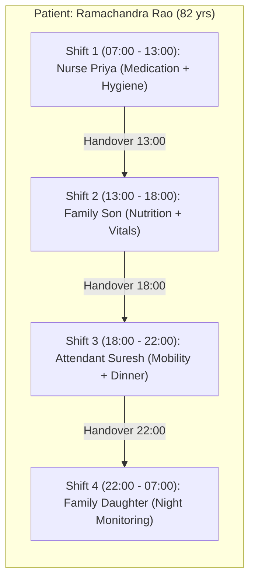
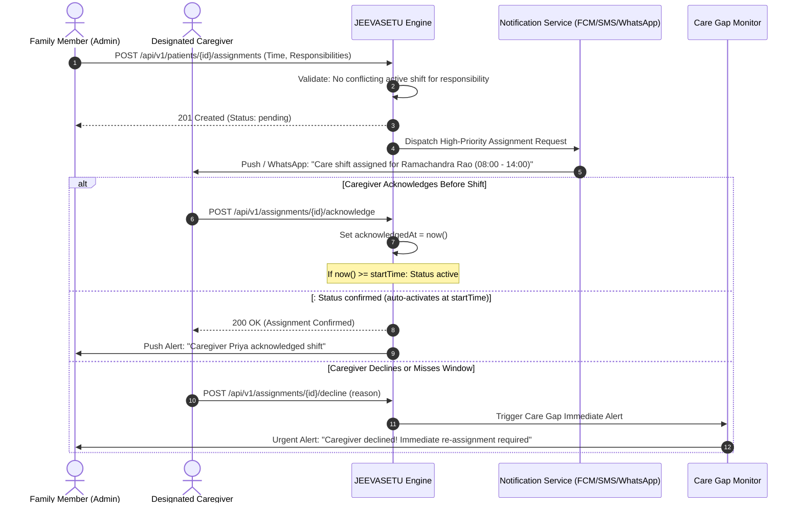
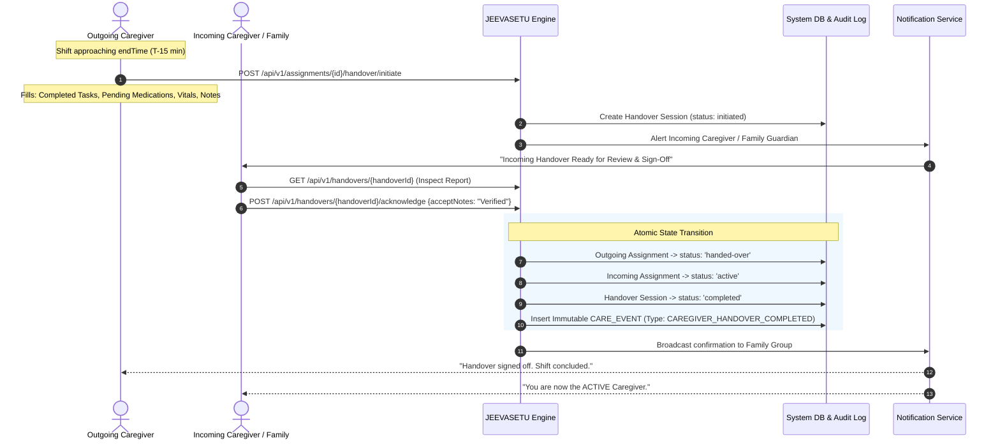
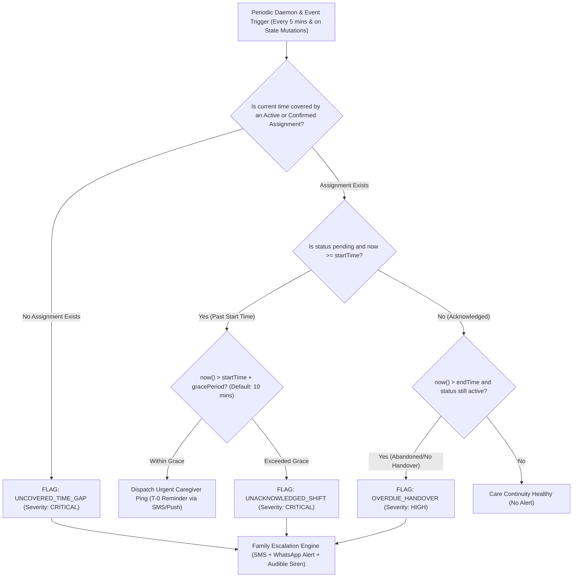

## 12. Caregiver Handover Workflow

The **Caregiver Handover Workflow** is the clinical and operational backbone of the **JEEVASETU** platform. It ensures continuous, uncompromised care delivery for elderly, post-operative, and chronically ill patients across distributed care teams—spanning primary family members, non-resident guardians, certified home-nurses, palliative attendants, and medical transport escorts.

This workflow guarantees that patient responsibility is unambiguously accounted for at every second of the day through formal assignment lifecycles, structured peer-to-peer handovers, care gap detection, and immutable care event audit logging.

---

### 12.1 Assignment Model

A patient in JEEVASETU often requires multi-disciplinary care across distinct parts of the day or week. The platform enforces a **Time-Bounded Responsibility Shift Model**:

1. **Multi-Caregiver Support**: A single patient can have multiple registered caregivers (family members, hired attendants, private-duty nurses, community volunteers).
2. **Defined Responsibility Periods (Shifts)**: Caregiver accountability is scoped strictly to bounded time slots defined by `startTime` and `endTime`.
3. **Responsibility Scoping**: Rather than open-ended custody, assignments declare explicit, granular responsibilities (e.g., critical medication delivery, physical therapy accompaniment, wound care, vitals tracking, nutritional intake).
4. **Primary vs. Delegated Authority**:
   - **Assigned By (Authorizer)**: Family admins or legal guardians retain delegative authority to create and revoke shifts.
   - **Assigned To (Assignee)**: The designated primary caregiver for the shift duration.
5. **Single-Active Invariant**: For any given core responsibility type (e.g., *General Care* or *Medication Administration*), only **one** caregiver may be in `active` status at any point in time to eliminate diffusion of responsibility.



---

### 12.2 Assignment Document Specification

The assignment entity represents a contracted or agreed interval of caregiving accountability.

| Field Name | Type | Description |
| :--- | :--- | :--- |
| `assignmentId` | `string` (UUID v4) | Unique identifier for the assignment record. |
| `patientId` | `string` (UUID v4) | Reference to the patient receiving care. |
| `caregiverId` | `string` (UUID v4) | Reference to the assigned caregiver (attendant or family member). |
| `assignedBy` | `string` (UUID v4) | User ID of the family admin or coordinator who scheduled the assignment. |
| `startTime` | `string` (ISO 8601) | Scheduled start timestamp for caregiver responsibility. |
| `endTime` | `string` (ISO 8601) | Scheduled end timestamp for caregiver responsibility. |
| `responsibilities` | `CareResponsibility[]` | Array of designated duties: `medication_administration`, `appointment_accompaniment`, `general_care`, `vitals_monitoring`, `hygiene_nutrition`, `emergency_standby`. |
| `status` | `AssignmentStatus` | State enum: `pending`, `active`, `completed`, `handed-over`, `cancelled`, `escalated`. |
| `acknowledgedAt` | `string` (ISO 8601) \| `null` | Exact timestamp when the caregiver explicitly confirmed responsibility. |
| `handoverId` | `string` (UUID v4) \| `null` | Reference to the closing handover session when transitioning to `handed-over`. |
| `emergencyRelease` | `boolean` | Flag indicating if this assignment was abruptly terminated via emergency protocol. |
| `notes` | `string` \| `null` | Special clinical notes, patient preferences, or gate-code instructions. |
| `createdAt` / `updatedAt` | `string` (ISO 8601) | System audit timestamps. |

#### Lifecycle States

- `pending`: Assignment created by family; awaiting caregiver acknowledgment.
- `active`: Caregiver has acknowledged and the current time is within `[startTime, endTime]`. The caregiver is legally and operationally accountable.
- `handed-over`: Outgoing caregiver has transferred responsibility to the next caregiver or family member with a signed-off handover report.
- `completed`: Shift concluded naturally (e.g., terminal single shift where responsibility returns to default household guardian without formal transfer protocol).
- `cancelled`: Revoked by family admin prior to shift initiation.
- `escalated`: Caregiver failed to acknowledge or abandon post-start; flagged by Care Gap Engine.

---

### 12.3 Caregiver Assignment Flow

The assignment workflow transitions care responsibility safely from scheduling to active fulfillment.



#### Step-by-Step Assignment Steps:
1. **Creation**: Family admin selects patient, target caregiver, schedule window (`startTime`, `endTime`), and checks required duties (`medication_administration`, `general_care`).
2. **Notification Dispatch**: JEEVASETU dispatches multi-channel alerts (In-App push notification, automated WhatsApp template, SMS backup for rural/intermittent connectivity).
3. **Review & Scope Verification**: Caregiver opens the notification, reviews patient vitals history, dietary restrictions, emergency contacts, and required checklist.
4. **Acknowledgment**: Caregiver clicks **"Acknowledge & Accept Responsibility"**.
5. **State Activation**:
   - If acknowledged ahead of time: Status is marked as `confirmed`. When the clock hits `startTime`, a scheduled worker transitions status to `active`.
   - If acknowledged at or after `startTime`: Status immediately transitions to `active`.

---

### 12.4 Caregiver Handover Flow

The handover protocol eliminates "blind spots" between consecutive shifts. No caregiver may drop active status without an explicit handover report signed off by the incoming caregiver or returned to a family guardian.



#### Detailed Handover Steps:

1. **Initiation**: The active outgoing caregiver taps **"Initiate Handover"** in the JEEVASETU caregiver portal:
   - Selects the incoming registered caregiver from the rota, or selects **"Return Responsibility to Family Admin"** if no subsequent professional is scheduled.
2. **Structured Handover Package Generation**:
   - **Completed Tasks**: Automatic pull of marked medication doses (e.g., *Ecosprin 75mg given at 08:30*), vitals logged (*BP 125/82, Pulse 74*), meals consumed, and diaper/hygiene changes.
   - **Pending & Immediate Tasks**: Next medication dose due (*Metformin 500mg at 13:30 post-lunch*), physical therapy appointment at 15:00.
   - **Clinical & Behavioral Notes**: Qualitative notes on patient demeanor, pain complaints, sleep quality, fluid intake, or low medication stock.
3. **Verification & Acknowledgment**:
   - Incoming caregiver reviews the summary in person or digitally.
   - Incoming caregiver signs off with a single-tap confirmation or biometric/PIN verification.
4. **Atomic Status Mutation**:
   - Outgoing assignment status moves: `active` → `handed-over`.
   - Incoming assignment status moves: `pending` / `confirmed` → `active`.
5. **Care Event Recordation**:
   - An immutable audit trail entry is inserted into the `CareEvents` ledger with category `CAREGIVER_HANDOVER_COMPLETED`, binding both user IDs, geolocation coordinates, and the complete handover summary payload.

---

### 12.5 Care Gap Detection Engine

A **Care Gap** is any time interval or operational state where the patient has care dependencies but lacks a confirmed, active caregiver. The JEEVASETU **Care Gap Detection Engine** runs as an event-driven and cron-evaluated guardian service.



#### Gap Conditions Monitored

1. **Unassigned Time Gap (`UNCOVERED_TIME_GAP`)**:
   - A prospective care window in the patient's daily care plan has no scheduled caregiver assignment within the next 2 hours or in the current moment.
2. **Unacknowledged Shift Past Start (`UNACKNOWLEDGED_SHIFT`)**:
   - An assignment reaches `startTime` while remaining in `pending` status.
   - **T-30 min**: System dispatches a friendly warning to the caregiver.
   - **T-0 min**: Urgent alert to caregiver.
   - **T+10 min (Grace Period Exceeded)**: Immediate escalation. The assignment is flagged as `escalated`, and high-urgency notifications are broadcast to all designated family guardians.
3. **Overdue Handover / Abandonment Gap (`OVERDUE_HANDOVER`)**:
   - An assignment remains `active` past its `endTime + 30 minutes` without an initiated handover. Alerts outgoing caregiver and family to ensure the caregiver did not abandon the patient without notice.

#### Escalation Tiers

- **Tier 1 (Caregiver Ping)**: Direct Push and WhatsApp reminder to scheduled caregiver.
- **Tier 2 (Primary Guardian)**: SMS and high-priority app alert to primary family coordinator.
- **Tier 3 (Emergency Broadcast)**: Automated phone call / IVR to secondary emergency family contacts and local community coordinator if primary fails to respond within 15 minutes.

---

### 12.6 Edge Cases & Failure Recovery

| Edge Case Scenario | Failure Mechanism | JEEVASETU Recovery Protocol |
| :--- | :--- | :--- |
| **Caregiver Does Not Acknowledge** | Caregiver phone battery dead, no response 10 min past `startTime`. | 1. Engine flags shift as `escalated`.<br/>2. System falls back automatically: Primary family member is marked temporary `active` caregiver.<br/>3. Red alert banner posted to Family Dashboard with one-click **"Reassign to Backup Caregiver"** button. |
| **Overlapping Assignments** | Admin mistakenly schedules two attendants at the same time window. | 1. **Validation Rejection**: System disallows identical responsibility types for conflicting intervals.<br/>2. **Orthogonal Allow**: If duties are complementary (e.g., Attendant A has `appointment_accompaniment` while Nurse B has `medication_administration`), the system permits simultaneous overlapping shifts with distinct task checklists. |
| **Emergency Handover** | Active caregiver suddenly collapses, suffers accident, or patient requires urgent hospitalization. | 1. **One-Tap Emergency Release**: Caregiver or family hits **"Emergency Handover / Release"**.<br/>2. Immediate prompt: "Transfer to EMS / Paramedics" or "Transfer to Family Guardian".<br/>3. Standard acknowledgment checks bypassed.<br/>4. All family members receive audible siren alert with current GPS and emergency contact info. |
| **Caregiver Declines Assignment** | Caregiver marks "Unavailable" after shift creation. | 1. Assignment status transitions to `cancelled`.<br/>2. Reason logged (e.g., sickness, transportation delay).<br/>3. Family alerted immediately with quick-picker for alternative caregivers in the family network. |
| **Offline / Low-Connectivity Handover** | Remote village or hospital basement with no 4G/WiFi. | 1. **Local Handover Token / QR Exchange**: Outgoing app generates an offline cryptographic QR code containing the handover summary hash.<br/>2. Incoming caregiver scans QR code to acknowledge receipt offline.<br/>3. Queued mutations sync to JEEVASETU cloud as soon as cellular data restores. |

---

### 12.7 Hackathon MVP vs. Production Architecture

To deliver an impactful, working demonstration within hackathon constraints while retaining a clean upgrade path to production, JEEVASETU stratifies complexity as follows:

```
+-------------------------------------------------------------------------+
| HACKATHON MVP SCOPE (Delivered in Core Demo)                            |
| - Single active caregiver per patient at any moment                     |
| - Explicit Assignment Creation (Family Admin) + Single-tap Acknowledge  |
| - Handover Flow: Completed tasks, pending tasks, notes, Incoming Ack    |
| - Basic Care Gap Check: Cron/Triggered detection of unacknowledged shift |
| - In-app Toast / Push alerts for family & caregivers                    |
+-------------------------------------------------------------------------+
                                    |
                                    v (Post-Hackathon Roadmap)
+-------------------------------------------------------------------------+
| PRODUCTION EXPANSION                                                    |
| - Multi-week recurring shift rotas (templates & automated rotation)     |
| - Fine-grained concurrent role overlap (Nurse + Physical Therapist)     |
| - Automated IVR voice-call escalation for unacknowledged shifts          |
| - LLM-powered Handover Summaries (Voice memo -> structured task report) |
| - Geo-fenced verification of physical arrival and departure             |
+-------------------------------------------------------------------------+
```

---

### 12.8 TypeScript Data Models

```typescript
/**
 * Core Responsibility Categories supported by JEEVASETU
 */
export type CareResponsibility =
  | 'medication_administration'
  | 'appointment_accompaniment'
  | 'general_care'
  | 'vitals_monitoring'
  | 'hygiene_nutrition'
  | 'emergency_standby';

/**
 * Status lifecycle for a Caregiver Assignment
 */
export type AssignmentStatus =
  | 'pending'
  | 'active'
  | 'completed'
  | 'handed-over'
  | 'cancelled'
  | 'escalated';

/**
 * Status of the Handover session
 */
export type HandoverStatus = 'initiated' | 'completed' | 'rejected' | 'emergency_released';

/**
 * Task item transferred during handover
 */
export interface HandoverTaskSummary {
  taskId: string;
  title: string;
  category: CareResponsibility;
  isCompleted: boolean;
  completedAt?: string; // ISO 8601
  notes?: string;
  dueTime?: string;     // ISO 8601 for pending tasks
}

/**
 * Structured Handover Report Document
 */
export interface HandoverDocument {
  handoverId: string;
  patientId: string;
  outgoingAssignmentId: string;
  outgoingCaregiverId: string;
  incomingCaregiverId: string; // May be family member ID if returning to family
  status: HandoverStatus;
  completedTasks: HandoverTaskSummary[];
  pendingTasks: HandoverTaskSummary[];
  clinicalObservations: string;
  vitalSignsSnapshot?: {
    systolicBp?: number;
    diastolicBp?: number;
    pulseRate?: number;
    bloodGlucoseMgDl?: number;
    spo2Percentage?: number;
    recordedAt: string;
  };
  initiatedAt: string;
  acknowledgedAt?: string;
  acknowledgmentNotes?: string;
  emergencyFlag: boolean;
}

/**
 * Primary Caregiver Assignment Document
 */
export interface CaregiverAssignment {
  assignmentId: string;
  patientId: string;
  caregiverId: string;
  caregiverName?: string;
  assignedBy: string; // Family Admin user ID
  startTime: string;  // ISO 8601
  endTime: string;    // ISO 8601
  responsibilities: CareResponsibility[];
  status: AssignmentStatus;
  acknowledgedAt: string | null;
  handoverId: string | null;
  notes: string | null;
  createdAt: string;
  updatedAt: string;
}

/**
 * Care Gap Alert Entity
 */
export type CareGapType = 
  | 'UNCOVERED_TIME_GAP' 
  | 'UNACKNOWLEDGED_SHIFT' 
  | 'OVERDUE_HANDOVER';

export type AlertSeverity = 'low' | 'medium' | 'high' | 'critical';

export interface CareGapAlert {
  alertId: string;
  patientId: string;
  gapType: CareGapType;
  severity: AlertSeverity;
  gapStartTime: string;
  gapEndTime?: string;
  assignmentId?: string;
  targetCaregiverId?: string;
  message: string;
  isResolved: boolean;
  resolvedAt?: string;
  notifiedContacts: string[]; // List of user IDs alerted
  createdAt: string;
}

/**
 * Immutable Care Event Audit Record
 */
export interface CareEvent {
  eventId: string;
  patientId: string;
  eventType: 
    | 'ASSIGNMENT_CREATED'
    | 'ASSIGNMENT_ACKNOWLEDGED'
    | 'HANDOVER_INITIATED'
    | 'CAREGIVER_HANDOVER_COMPLETED'
    | 'CARE_GAP_DETECTED'
    | 'EMERGENCY_RELEASE_TRIGGERED';
  triggeredByUserId: string;
  assignmentId?: string;
  handoverId?: string;
  payload: Record<string, unknown>;
  timestamp: string;
}
```

---

### 12.9 REST API Endpoints Specification

All endpoints are authenticated via JWT Bearer tokens and require appropriate role permissions (`FAMILY_ADMIN`, `CAREGIVER`, or `PATIENT_PROXY`).

#### 1. Create Caregiver Assignment
- **Endpoint**: `POST /api/v1/patients/{patientId}/assignments`
- **Description**: Family member assigns responsibility window and duties to a designated caregiver.
- **Request Body**:
```json
{
  "caregiverId": "c4b8e21a-7b32-4e6f-98f5-19e48a339021",
  "startTime": "2026-11-15T14:00:00+05:30",
  "endTime": "2026-11-15T20:00:00+05:30",
  "responsibilities": [
    "medication_administration",
    "general_care",
    "vitals_monitoring"
  ],
  "notes": "Give post-lunch insulin at 14:30. Check BP before evening walk."
}
```
- **Response**: `201 Created`
```json
{
  "assignmentId": "a918f031-419b-4654-8c43-bc027de85611",
  "patientId": "p902-ramachandra",
  "caregiverId": "c4b8e21a-7b32-4e6f-98f5-19e48a339021",
  "status": "pending",
  "acknowledgedAt": null,
  "createdAt": "2026-11-15T10:35:00+05:30"
}
```

#### 2. Caregiver Acknowledges Assignment
- **Endpoint**: `POST /api/v1/assignments/{assignmentId}/acknowledge`
- **Description**: Caregiver confirms availability and accepts legal/operational care responsibility.
- **Request Body**: `{}` (Empty or optional device metadata)
- **Response**: `200 OK`
```json
{
  "assignmentId": "a918f031-419b-4654-8c43-bc027de85611",
  "status": "active",
  "acknowledgedAt": "2026-11-15T10:40:12+05:30",
  "message": "Assignment successfully acknowledged and active."
}
```

#### 3. Initiate Handover (Outgoing Caregiver)
- **Endpoint**: `POST /api/v1/assignments/{assignmentId}/handover/initiate`
- **Description**: Outgoing caregiver packages shift progress, pending tasks, and notes for the next caregiver or family member.
- **Request Body**:
```json
{
  "incomingCaregiverId": "u812-son-vikram",
  "completedTasks": [
    {
      "taskId": "t-001",
      "title": "Insulin Administration 10U",
      "category": "medication_administration",
      "isCompleted": true,
      "completedAt": "2026-11-15T14:35:00+05:30"
    }
  ],
  "pendingTasks": [
    {
      "taskId": "t-002",
      "title": "Evening BP Check & Amlodipine 5mg",
      "category": "medication_administration",
      "isCompleted": false,
      "dueTime": "2026-11-15T19:00:00+05:30"
    }
  ],
  "clinicalObservations": "Patient had mild ankle edema today. Kept feet elevated for 30 mins.",
  "vitalsSnapshot": {
    "systolicBp": 128,
    "diastolicBp": 82,
    "pulseRate": 72,
    "recordedAt": "2026-11-15T18:00:00+05:30"
  }
}
```
- **Response**: `201 Created`
```json
{
  "handoverId": "h-5509-bc3e",
  "status": "initiated",
  "incomingCaregiverId": "u812-son-vikram",
  "initiatedAt": "2026-11-15T19:45:00+05:30"
}
```

#### 4. Acknowledge Handover Receipt (Incoming Caregiver)
- **Endpoint**: `POST /api/v1/handovers/{handoverId}/acknowledge`
- **Description**: Incoming caregiver signs off receipt, completing the outgoing shift and activating the incoming shift atomically.
- **Request Body**:
```json
{
  "acknowledgmentNotes": "Received patient in stable condition. Medication cabinet verified."
}
```
- **Response**: `200 OK`
```json
{
  "handoverId": "h-5509-bc3e",
  "status": "completed",
  "outgoingAssignmentStatus": "handed-over",
  "incomingAssignmentStatus": "active",
  "careEventId": "evt-7712-handover",
  "acknowledgedAt": "2026-11-15T20:00:15+05:30"
}
```

#### 5. Emergency Caregiver Release
- **Endpoint**: `POST /api/v1/assignments/{assignmentId}/emergency-release`
- **Description**: Immediate emergency termination of assignment, bypassing standard handover checklist and alerting family group instantly.
- **Request Body**:
```json
{
  "reason": "Emergency medical transfer to Apollo Hospital via 108 ambulance.",
  "transferredTo": "Paramedic Team / Hospital Ward"
}
```
- **Response**: `200 OK`
```json
{
  "assignmentId": "a918f031-419b-4654-8c43-bc027de85611",
  "status": "completed",
  "emergencyRelease": true,
  "careGapAlertId": "gap-911-alert",
  "timestamp": "2026-11-15T17:15:00+05:30"
}
```

#### 6. Detect & Query Care Gaps
- **Endpoint**: `GET /api/v1/patients/{patientId}/care-gaps`
- **Description**: Surfaces unresolved schedule gaps, unacknowledged assignments, or overdue handovers.
- **Query Params**: `?includeResolved=false`
- **Response**: `200 OK`
```json
{
  "patientId": "p902-ramachandra",
  "activeGapsCount": 1,
  "gaps": [
    {
      "alertId": "gap-441-unack",
      "gapType": "UNACKNOWLEDGED_SHIFT",
      "severity": "critical",
      "assignmentId": "a918f031-419b-4654-8c43-bc027de85611",
      "targetCaregiverId": "c4b8e21a-7b32-4e6f-98f5-19e48a339021",
      "message": "Caregiver Priya has not acknowledged shift starting at 14:00 (15 minutes overdue).",
      "isResolved": false,
      "createdAt": "2026-11-15T14:10:00+05:30"
    }
  ]
}
```
