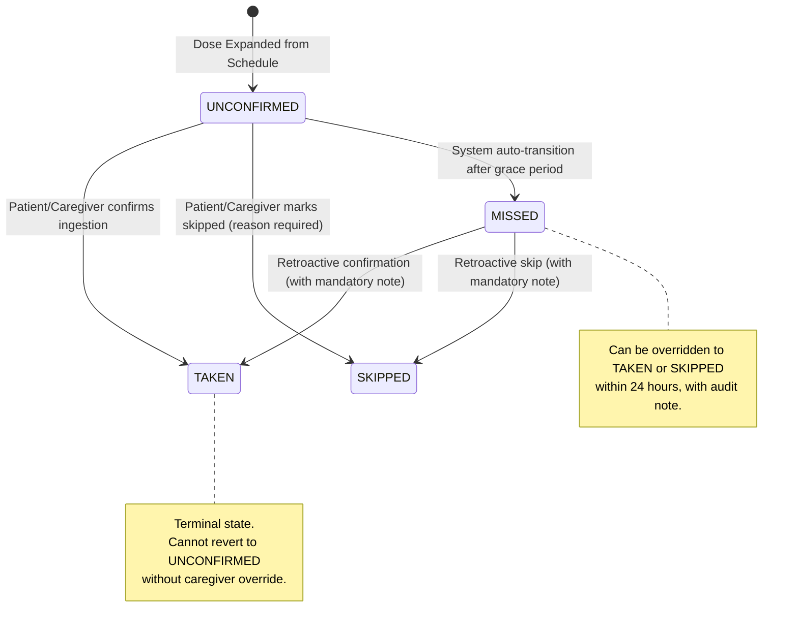

### 8.1 Medication Schedule Data Model

The medication scheduling subsystem within JEEVASETU is designed to provide a safe, auditable, and clinically conservative infrastructure for defining when and how elderly patients should take their prescribed medications. Every design decision in this data model is governed by the platform's overarching clinical safety invariant: **the system never makes automatic medical decisions**. It records, reminds, tracks, and reports — but all therapeutic judgements remain the exclusive domain of licensed healthcare providers and informed caregivers.

> [!CAUTION]
> **Zero Autonomous Medical Decision-Making Invariant**
> JEEVASETU strictly functions as an operational adherence tracker, schedule coordination bridge, and reminder communication system. It **never** calculates make-up doses, recommends double doses after missed events, dynamically alters dose amounts based on adherence history, discontinues or substitutes medications, or overrides minimum safe intervals for PRN medications. All system alerts regarding missed doses or schedule deviations are strictly informative and direct the patient or caregiver to consult their prescribing clinician.

#### 8.1.1 MedicationDefinition Interface

Before a medication can be scheduled, it must exist as a known entity in the platform's medication reference catalog. The `MedicationDefinition` interface captures the pharmacological identity of a drug independent of any particular patient or schedule. This reference data is populated from curated drug databases and serves as the canonical source of truth for drug names, forms, strengths, and safety warnings.

```typescript
/**
 * Represents a known medication entity in the JEEVASETU drug reference catalog.
 * This is NOT a patient-specific record — it is reference/master data describing
 * a medication product that can be prescribed and scheduled for any patient.
 *
 * Clinical Safety: This interface contains informational warnings and side effects
 * for display purposes only. The system NEVER uses these fields to make automated
 * clinical decisions such as contraindication blocking or interaction prevention.
 */
export interface MedicationDefinition {
  /** Globally unique identifier for this medication definition. */
  id: string;

  /**
   * Primary display name for the medication.
   * May be a brand name (e.g., "Glucophage") or a generic name (e.g., "Metformin").
   * For hackathon MVP, this is a free-text field populated from a local autocomplete list.
   */
  name: string;

  /**
   * International Nonproprietary Name (INN) or generic chemical name.
   * Used for duplicate therapy detection and cross-referencing.
   * Example: "Metformin Hydrochloride"
   */
  genericName: string;

  /**
   * Pharmaceutical dosage form describing the physical preparation of the medication.
   * This affects how patients interact with the medication (swallowing, applying,
   * inhaling, injecting) and influences UI presentation (e.g., showing a syringe
   * icon for injections vs. a pill icon for tablets).
   */
  form: 'tablet' | 'capsule' | 'liquid' | 'injection' | 'topical' | 'inhaler' | 'drops' | 'patch' | 'suppository' | 'powder';

  /**
   * Numeric strength value of the active pharmaceutical ingredient.
   * Examples: "500", "10", "0.25", "100/5" (combination products).
   * Stored as string to accommodate combination products and fractional strengths.
   */
  strength: string;

  /**
   * Unit of measure for the strength value.
   * Examples: "mg", "mcg", "ml", "mg/5ml", "IU", "units"
   */
  strengthUnit: string;

  /**
   * Clinical warnings associated with this medication.
   * Displayed to patients and caregivers for informational awareness only.
   * These warnings are NEVER used to block or alter medication schedules automatically.
   *
   * Examples:
   *   - "May cause drowsiness. Avoid driving or operating heavy machinery."
   *   - "Take on an empty stomach, at least 30 minutes before breakfast."
   *   - "Do not consume grapefruit or grapefruit juice while taking this medication."
   */
  warnings: string[];

  /**
   * Known side effects for patient and caregiver awareness.
   * Displayed in the medication detail view; never triggers automated schedule changes.
   *
   * Examples:
   *   - "Nausea, diarrhea, stomach upset (common, usually temporary)"
   *   - "Dizziness when standing up quickly (report if persistent)"
   */
  sideEffects: string[];
}
```

The `MedicationDefinition` serves as a reference catalog entry. For the hackathon MVP, this catalog is a locally stored JSON file with approximately 200 common elderly-care medications. In production, this would integrate with the NIH RxNorm API, FDA NDC database, or India's CDSCO drug registry for comprehensive coverage.

#### 8.1.2 MedicationSchedule Interface

The `MedicationSchedule` is the central entity that binds a specific medication to a specific patient with precise temporal instructions. It encodes what medication is taken, at what dosage, how frequently, at which times of day, and who prescribed it. Each schedule is an independent, versionable record that can be created, modified (with verification), paused, or discontinued.

```typescript
/**
 * Defines the temporal rules for when and how a patient should take a specific
 * medication. This is the core scheduling entity — it does NOT represent
 * individual dose events (those are expanded from this definition).
 *
 * A schedule must be VERIFIED by an authorized caregiver before it becomes ACTIVE
 * and begins generating expected dose events.
 */
export interface MedicationSchedule {
  /** UUID primary key. */
  id: string;

  /** UUID of the patient this schedule belongs to. */
  patientId: string;

  /**
   * Display name of the medication (should match or reference a MedicationDefinition).
   * Example: "Metformin 500mg", "Amlodipine 5mg"
   */
  medicationName: string;

  /**
   * Numeric dosage amount to be taken at each scheduled time.
   * Examples: "1" (one tablet), "500" (500mg), "2.5" (2.5ml), "2" (two puffs)
   * Stored as string to support fractional doses and avoid floating-point issues.
   */
  dosage: string;

  /**
   * Unit for the dosage value. This may differ from the MedicationDefinition's
   * strengthUnit when doses are expressed in tablets/capsules rather than mg.
   * Examples: "tablet", "capsule", "ml", "puff", "drop", "unit", "mg"
   */
  dosageUnit: string;

  /**
   * Frequency type that determines the recurrence pattern for this schedule.
   * The interpretation of scheduledTimes and frequencyConfig depends on this value.
   */
  frequency: FrequencyType;

  /**
   * Additional configuration parameters that vary by frequency type.
   * See FrequencyConfig interface for details per frequency type.
   */
  frequencyConfig: FrequencyConfig;

  /**
   * Array of times in 'HH:mm' format (24-hour notation) when the medication
   * should be taken on applicable days.
   *
   * These times are in the patient's local timezone (specified by patientTimezone).
   *
   * Examples:
   *   - Daily morning medication: ["08:00"]
   *   - Twice daily: ["08:00", "20:00"]
   *   - Three times daily with meals: ["07:30", "13:00", "19:30"]
   *
   * For PRN medications, this array is empty (no fixed times).
   */
  times: string[];

  /**
   * Date when the schedule becomes effective (inclusive). Format: 'YYYY-MM-DD'.
   * The expansion engine will not generate dose events before this date.
   */
  startDate: string;

  /**
   * Optional date when the schedule ends (inclusive). Format: 'YYYY-MM-DD'.
   * null or undefined indicates an ongoing/chronic medication with no predetermined end.
   *
   * When set, the expansion engine will not generate dose events after this date.
   * When a schedule is DISCONTINUED, endDate is set to the discontinuation date.
   */
  endDate?: string | null;

  /**
   * Free-text clinical instructions for the patient/caregiver.
   * Examples:
   *   - "Take with food and a full glass of water"
   *   - "Take 30 minutes before breakfast on an empty stomach"
   *   - "Apply thin layer to affected area and wash hands after"
   *   - "Shake well before use. Use the provided measuring cup."
   */
  instructions?: string;

  /**
   * Name of the prescribing clinician or healthcare provider.
   * Displayed for patient reference and audit purposes.
   */
  prescribedBy: string;

  /**
   * Current operational status of this schedule.
   */
  activeStatus: ScheduleActiveStatus;

  /**
   * Whether this schedule has been verified by an authorized caregiver.
   * Schedules in 'PENDING_VERIFICATION' status do not generate dose events.
   */
  verificationStatus: VerificationStatus;

  /**
   * IANA timezone identifier for the patient's primary location.
   * All times in the `times` array are interpreted in this timezone.
   * Examples: "Asia/Kolkata", "America/New_York", "Europe/London"
   */
  patientTimezone: string;

  /** UUID of the user who created this schedule record. */
  createdBy: string;

  /** ISO 8601 timestamp of when this schedule was first created. */
  createdAt: string;

  /** ISO 8601 timestamp of the most recent modification to this schedule. */
  updatedAt: string;

  /** Current version number. Incremented on each verified change. */
  currentVersion: number;
}
```

#### 8.1.3 Frequency Modeling

The frequency model is designed to cover the four fundamental recurrence patterns encountered in elderly medication management while keeping the expansion algorithm tractable and predictable. Each frequency type has its own semantic interpretation and configuration requirements.

```typescript
/**
 * Enumeration of supported schedule recurrence patterns.
 */
export type FrequencyType = 'DAILY' | 'SPECIFIC_DAYS' | 'INTERVAL' | 'PRN';

/**
 * Configuration parameters for each frequency type.
 * Which fields are relevant depends on the parent schedule's frequencyType.
 */
export interface FrequencyConfig {
  /**
   * [SPECIFIC_DAYS only] Array of ISO weekday numbers on which the medication
   * should be taken. 1 = Monday, 2 = Tuesday, ..., 7 = Sunday.
   *
   * Example: [1, 3, 5] means Monday, Wednesday, Friday.
   * Must contain at least one day and no duplicates.
   */
  daysOfWeek?: number[];

  /**
   * [INTERVAL only] The medication is taken every N days, starting from anchorDate.
   * Example: intervalDays = 2 means every other day.
   * Must be >= 2 (intervalDays = 1 is equivalent to DAILY).
   */
  intervalDays?: number;

  /**
   * [INTERVAL only] The reference starting date for interval calculation.
   * Format: 'YYYY-MM-DD'. Defaults to the schedule's startDate if not specified.
   *
   * The expansion engine determines eligibility for date D by computing:
   *   daysSinceAnchor = daysBetween(anchorDate, D)
   *   isScheduledDay = (daysSinceAnchor % intervalDays) === 0
   */
  anchorDate?: string;

  /**
   * [PRN only] Minimum number of hours that must elapse between consecutive doses.
   * This is a SAFETY DISPLAY parameter — the system warns the patient/caregiver
   * when they attempt to log a dose within this interval, but does NOT prevent
   * the recording (to maintain accurate clinical intake history).
   *
   * Example: 4 means at least 4 hours between doses of Ibuprofen.
   */
  minIntervalHours?: number;

  /**
   * [PRN only] Maximum number of doses permitted in a rolling 24-hour period.
   * Like minIntervalHours, this triggers a warning, not a hard block.
   *
   * Example: 4 means maximum 4 doses of Paracetamol per 24 hours.
   */
  maxDailyDoses?: number;
}
```

**Frequency type behavioral summary:**

| Frequency Type | Expansion Behavior | Example Clinical Use Case |
| :--- | :--- | :--- |
| `DAILY` | Generates dose events for every day within the schedule's date range at each time in the `times` array. | Metformin 500mg twice daily for Type 2 Diabetes management. |
| `SPECIFIC_DAYS` | Generates dose events only on the specified weekdays within the schedule's date range. | Methotrexate once weekly on Mondays for Rheumatoid Arthritis. |
| `INTERVAL` | Generates dose events every N days from the anchor date. The anchor date establishes the phase of the repeating cycle. | Vitamin B12 injection every 14 days. Iron supplementation every 3 days. |
| `PRN` | Does **not** generate scheduled dose events. Instead, doses are logged on-demand when the patient takes the medication. Tracked separately on a utilization ledger with interval and daily-max safety warnings. | Sublingual Nitroglycerin for acute angina. Rescue inhaler for COPD exacerbation. SOS Paracetamol for breakthrough pain. |

#### 8.1.4 Supporting Type Definitions

```typescript
export type ScheduleActiveStatus = 'ACTIVE' | 'INACTIVE' | 'PAUSED' | 'DISCONTINUED';
export type VerificationStatus = 'PENDING_VERIFICATION' | 'VERIFIED' | 'REJECTED';
export type AdherenceState = 'UNCONFIRMED' | 'TAKEN' | 'SKIPPED' | 'MISSED';
export type ActorRole = 'PATIENT' | 'CAREGIVER' | 'SYSTEM_DAEMON' | 'CLINICIAN';
export type EventSource = 'MANUAL' | 'OFFLINE_SYNC' | 'SYSTEM';
```

---

### 8.2 Schedule Expansion Algorithm

Schedule definitions represent prospective recurring rules. To track real-time adherence, dispatch reminder notifications, and populate the patient's daily medication view, the system must deterministically expand schedule rules into concrete, individual dose instances for any given query interval.

#### 8.2.1 Core Concept: Expected Dose

An `ExpectedDose` is a single, concrete instance of a medication that a patient should take at a specific date and time. Expected doses are generated ("expanded") from `MedicationSchedule` definitions by applying the schedule's frequency rules across a date range.

```typescript
/**
 * A single concrete dose instance expanded from a MedicationSchedule.
 * Represents one specific moment when a patient is expected to take a medication.
 *
 * On creation (during expansion), the status defaults to UNCONFIRMED and transitions
 * through the adherence state machine as events are recorded.
 */
export interface ExpectedDose {
  /** UUID of the parent MedicationSchedule that generated this dose. */
  scheduleId: string;

  /** Reference to the medication (name or ID from MedicationDefinition). */
  medicationId: string;

  /** The date on which this dose is expected. Format: 'YYYY-MM-DD' (patient local). */
  scheduledDate: string;

  /** The time at which this dose is expected. Format: 'HH:mm' (patient local). */
  scheduledTime: string;

  /** UTC timestamp computed from scheduledDate + scheduledTime + patient timezone. */
  scheduledTimestampUtc: string;

  /**
   * Current adherence status. Defaults to UNCONFIRMED when the dose is first expanded.
   * Transitions to TAKEN, SKIPPED, or MISSED through the adherence state machine.
   */
  status: AdherenceState;

  /**
   * Deterministic idempotency key for deduplication.
   * Formula: {scheduleId}_{medicationId}_{scheduledDate}_{scheduledTime}
   */
  idempotencyKey: string;
}
```

#### 8.2.2 The generateExpectedDoses Function

The primary expansion function accepts a patient ID and a date range, retrieves all active, verified schedules for that patient, and expands each schedule into concrete `ExpectedDose` objects. This function is the authoritative source for determining "what medications should this patient take today?"

```typescript
import { DateTime } from 'luxon';

/**
 * Generates all expected dose instances for a patient within a date range.
 *
 * This function is PURE and DETERMINISTIC: given the same schedules and date range,
 * it always produces the same output. It does not read from or write to the database;
 * it operates on in-memory schedule objects.
 *
 * @param schedules - All MedicationSchedule records for the patient (pre-filtered
 *                    for activeStatus = ACTIVE and verificationStatus = VERIFIED)
 * @param patientId - UUID of the patient
 * @param startDate - Start of the query range, inclusive ('YYYY-MM-DD')
 * @param endDate   - End of the query range, inclusive ('YYYY-MM-DD')
 * @param timezone  - IANA timezone for expansion (e.g., 'Asia/Kolkata')
 * @returns Array of ExpectedDose objects sorted by scheduledTimestampUtc ascending
 */
export function generateExpectedDoses(
  schedules: MedicationSchedule[],
  patientId: string,
  startDate: string,
  endDate: string,
  timezone: string
): ExpectedDose[] {
  const doses: ExpectedDose[] = [];

  const rangeStart = DateTime.fromISO(startDate, { zone: timezone }).startOf('day');
  const rangeEnd = DateTime.fromISO(endDate, { zone: timezone }).endOf('day');

  for (const schedule of schedules) {
    // Guard: only expand ACTIVE + VERIFIED schedules
    if (schedule.activeStatus !== 'ACTIVE' || schedule.verificationStatus !== 'VERIFIED') {
      continue;
    }

    // Guard: PRN medications do not produce scheduled expected doses
    if (schedule.frequency === 'PRN') {
      continue;
    }

    const schedStart = DateTime.fromISO(schedule.startDate, { zone: timezone }).startOf('day');
    const schedEnd = schedule.endDate
      ? DateTime.fromISO(schedule.endDate, { zone: timezone }).endOf('day')
      : null;

    // Determine effective iteration bounds (intersection of query range and schedule range)
    let iterDate = rangeStart < schedStart ? schedStart : rangeStart;
    const iterEnd = schedEnd && schedEnd < rangeEnd ? schedEnd : rangeEnd;

    while (iterDate <= iterEnd) {
      // Apply frequency recurrence gate
      const isScheduledDay = evaluateRecurrenceGate(schedule, iterDate, timezone);

      if (isScheduledDay) {
        const dateStr = iterDate.toISODate()!; // 'YYYY-MM-DD'

        for (const localTime of schedule.times) {
          const [hours, minutes] = localTime.split(':').map(Number);

          const doseDateTime = iterDate.set({
            hour: hours,
            minute: minutes,
            second: 0,
            millisecond: 0,
          });

          const utcTimestamp = doseDateTime.toUTC().toISO()!;

          // Build deterministic idempotency key
          const medId = schedule.medicationName
            .toLowerCase()
            .replace(/[^a-z0-9]/g, '');
          const timeKey = localTime.replace(':', '');
          const idempotencyKey = `${schedule.id}_${medId}_${dateStr}_${timeKey}`;

          doses.push({
            scheduleId: schedule.id,
            medicationId: medId,
            scheduledDate: dateStr,
            scheduledTime: localTime,
            scheduledTimestampUtc: utcTimestamp,
            status: 'UNCONFIRMED',
            idempotencyKey,
          });
        }
      }

      iterDate = iterDate.plus({ days: 1 });
    }
  }

  // Sort chronologically by UTC timestamp for consistent ordering
  doses.sort((a, b) =>
    a.scheduledTimestampUtc.localeCompare(b.scheduledTimestampUtc)
  );

  return doses;
}

/**
 * Evaluates whether a schedule is active on a given date based on its frequency type.
 *
 * @param schedule - The medication schedule to evaluate
 * @param date     - The date to check (Luxon DateTime in patient timezone)
 * @param timezone - IANA timezone string
 * @returns true if the schedule calls for doses on this date
 */
function evaluateRecurrenceGate(
  schedule: MedicationSchedule,
  date: DateTime,
  timezone: string
): boolean {
  switch (schedule.frequency) {
    case 'DAILY':
      return true;

    case 'SPECIFIC_DAYS': {
      const dayOfWeek = date.weekday; // 1=Monday … 7=Sunday (ISO)
      const allowed = schedule.frequencyConfig.daysOfWeek ?? [];
      return allowed.includes(dayOfWeek);
    }

    case 'INTERVAL': {
      const anchorStr = schedule.frequencyConfig.anchorDate || schedule.startDate;
      const anchor = DateTime.fromISO(anchorStr, { zone: timezone }).startOf('day');
      const diffDays = Math.floor(date.diff(anchor, 'days').days);
      const interval = schedule.frequencyConfig.intervalDays || 1;
      return diffDays >= 0 && diffDays % interval === 0;
    }

    case 'PRN':
      return false; // PRN never generates scheduled doses

    default:
      return false;
  }
}
```

#### 8.2.3 Timezone Handling

All scheduled times are stored as local wall-clock times in the `times` array, paired with a `patientTimezone` (IANA timezone identifier such as `"Asia/Kolkata"` or `"America/New_York"`). The expansion algorithm converts these local times to UTC timestamps using the Luxon date-time library, which correctly handles Daylight Saving Time (DST) transitions, historical timezone rule changes, and sub-hour UTC offsets (e.g., India's UTC+05:30, Nepal's UTC+05:45).

**Key timezone design decisions:**

1. **Storage**: Schedule times stored as local `HH:mm` strings. Expanded dose events store both the local time and the computed UTC timestamp. The database `adherence_events` table stores `scheduled_timestamp_utc` as `TIMESTAMPTZ` for global ordering and grace-period calculations.

2. **Display**: The UI always displays times in the patient's configured timezone. If a patient is in `Asia/Kolkata`, their 08:00 dose displays as "8:00 AM" regardless of the server's timezone or the viewing caregiver's timezone.

3. **Travel / timezone change**: When a patient's timezone changes (e.g., traveling from India to the US), the system re-expands future doses using the new timezone but does not retroactively modify past dose records. A timezone change of 3 or more hours triggers an informational alert suggesting the patient consult their clinician about dosing interval adjustments — the system does **not** automatically adjust any doses.

4. **DST handling**: During spring-forward transitions, doses scheduled in the skipped hour (e.g., 02:30 AM in US timezones) are mapped forward to the first valid minute of the next hour. During fall-back transitions, doses in the repeated hour resolve to the earlier occurrence to avoid duplication. The idempotency key uses the nominal local time, preventing double-event generation.

#### 8.2.4 Schedule Changes Mid-Day

When a schedule is modified during the day (e.g., a physician increases the dose at 13:00), the change follows a strict temporal slicing rule: **only future, unexpanded or still-UNCONFIRMED doses are affected**. Past doses that have already been recorded as TAKEN, SKIPPED, or MISSED remain permanently locked to the schedule version that was active when they were generated. This ensures clinical consistency — a patient's 08:00 dose of 5mg remains recorded as 5mg even if the dose is increased to 10mg at 13:00. The daily adherence denominator for the transition day represents the union of historical fulfilled slots under the old version and newly activated prospective slots under the new version.

---

### 8.3 Adherence State Machine

Each expanded dose instance follows a deterministic four-state lifecycle with strict, auditable transition rules. The state machine ensures that every medication event has a clear, traceable history from initial expansion through final resolution.

#### 8.3.1 The Four States

| State | Description | Visual Indicator |
| :--- | :--- | :--- |
| `UNCONFIRMED` | The dose event has been generated (expanded from the schedule) but no action has been taken. The dose window may be approaching, currently open, or in the late/grace period. | Gray circle / pending icon |
| `TAKEN` | The patient or caregiver has confirmed that the medication was ingested/applied/administered. | Green checkmark |
| `SKIPPED` | The patient or caregiver has deliberately marked the dose as intentionally not taken, with a documented reason. | Yellow skip icon |
| `MISSED` | The configurable grace period has expired without the dose being confirmed as taken or skipped. The system daemon automatically transitions to this state. | Red X icon |

#### 8.3.2 State Transition Diagram



#### 8.3.3 Transition Rules and Authority Matrix

**Who can transition states:**

| Transition | Patient | Caregiver | System Daemon | Clinician |
| :--- | :---: | :---: | :---: | :---: |
| UNCONFIRMED → TAKEN | ✅ | ✅ | ❌ | ✅ |
| UNCONFIRMED → SKIPPED | ✅ | ✅ | ❌ | ✅ |
| UNCONFIRMED → MISSED | ❌ | ❌ | ✅ | ❌ |
| MISSED → TAKEN | ✅ | ✅ | ❌ | ✅ |
| MISSED → SKIPPED | ❌ | ✅ | ❌ | ✅ |

**Transition validation rules:**

1. **UNCONFIRMED → TAKEN**: Permitted when current time is within the dose window ($T - 60\text{ min}$ to $T + \text{gracePeriod}$). The `actualTime` is recorded, and `isLate` is computed by comparing `actualTime` to the scheduled time. If `actualTime > scheduledTime + 2 hours`, the dose is flagged as late.

2. **UNCONFIRMED → SKIPPED**: Requires a mandatory `reason` field. Valid skip reasons include `'NAUSEA'`, `'FASTING_FOR_LABS'`, `'PHYSICIAN_INSTRUCTED'`, `'SIDE_EFFECTS'`, `'REFUSED'`, `'OUT_OF_STOCK'`, and `'OTHER'` (with free-text note). The system dispatches an alert to the caregiver if the medication is flagged as high-risk (e.g., anti-epileptic, insulin, anticoagulant).

3. **UNCONFIRMED → MISSED**: Exclusively triggered by the system daemon. The default grace period is **2 hours** past the scheduled time, configurable per schedule (with a maximum of 4 hours). This transition fires automatically via a background cron job that sweeps all UNCONFIRMED events whose `scheduledTimestampUtc + gracePeriod < NOW()`.

4. **MISSED → TAKEN / SKIPPED (Override)**: Allowed within 24 hours of the original scheduled time. A mandatory `notes` field must explain why the status is being corrected (e.g., "Patient took medication on time but phone was not available to log"). The override is recorded with full audit metadata including who made the change, when, and why.

5. **TAKEN → UNCONFIRMED**: This reverse transition is **not permitted** in the standard workflow. Once a dose is confirmed as taken, it cannot be reverted to UNCONFIRMED. If a caregiver discovers an erroneous tap (accidental confirmation), they must contact platform support for an audited correction, which is logged as a separate correction event rather than a state reversion. This prevents patients from accidentally "undoing" legitimate dose confirmations.

6. **SKIPPED → UNCONFIRMED**: Not permitted after the grace period has expired and the event has been finalized. Before the grace period expires, a caregiver can cancel a skip and return the dose to UNCONFIRMED status, but this window is narrow and audited.

#### 8.3.4 MedicationEvent Interface

Every state transition is recorded as an immutable `MedicationEvent`. This is the core adherence record that powers analytics, caregiver dashboards, and clinical reports.

```typescript
/**
 * Represents a single adherence event — the state of one dose at one point in time.
 * This record is created when a dose is first expanded (status = UNCONFIRMED) and
 * updated as the patient/caregiver/system transitions the status.
 *
 * Each event is uniquely identified by its idempotencyKey, which prevents
 * duplicate recordings even under network retries or offline sync scenarios.
 */
export interface MedicationEvent {
  /** UUID primary key for this event record. */
  eventId: string;

  /** UUID of the parent MedicationSchedule. */
  scheduleId: string;

  /** Sanitized medication identifier (derived from medication name). */
  medicationId: string;

  /** UUID of the patient. */
  patientId: string;

  /** Scheduled date in patient's local timezone. Format: 'YYYY-MM-DD'. */
  scheduledDate: string;

  /** Scheduled time in patient's local timezone. Format: 'HH:mm'. */
  scheduledTime: string;

  /** Current adherence state of this dose event. */
  status: AdherenceState;

  /**
   * Actual time the medication was taken, if status is TAKEN.
   * ISO 8601 timestamp. null for SKIPPED, MISSED, or UNCONFIRMED events.
   * Used to calculate lateness and actual dosing intervals.
   */
  actualTime: string | null;

  /**
   * UUID of the user who last transitioned this event's status.
   * null for UNCONFIRMED events (set by expansion) and for SYSTEM_DAEMON
   * auto-transitions to MISSED.
   */
  recordedBy: string | null;

  /** ISO 8601 timestamp of when the status was last changed. */
  recordedAt: string;

  /**
   * Free-text notes associated with this event.
   * Required for SKIPPED events (must include reason) and for MISSED→TAKEN overrides.
   * Optional for standard TAKEN confirmations.
   */
  notes: string | null;

  /**
   * How this event was recorded.
   * - 'MANUAL': Patient or caregiver tapped the confirmation button in real-time.
   * - 'OFFLINE_SYNC': Recorded on the device while offline and synced later.
   * - 'SYSTEM': Automated transition by the system daemon (e.g., MISSED auto-mark).
   */
  source: EventSource;

  /**
   * Deterministic idempotency key for deduplication.
   * Formula: {scheduleId}_{medicationId}_{scheduledDate}_{scheduledTime}
   *
   * This key is UNIQUE in the database. Any attempt to insert a duplicate key
   * triggers the ON CONFLICT upsert logic rather than creating a second event.
   */
  idempotencyKey: string;

  /** Whether this dose was taken later than the on-time window. */
  isLate: boolean;

  /** Number of minutes past the scheduled time when the dose was taken. 0 if on time. */
  minutesLate: number;

  /** ISO 8601 timestamp when this record was first created. */
  createdAt: string;

  /** ISO 8601 timestamp of the most recent update to this record. */
  updatedAt: string;
}
```

---

### 8.4 Adherence Calculation

Adherence metrics quantify how consistently a patient takes their prescribed medications. These metrics power caregiver dashboards, trend graphs, clinical reports, and alert thresholds. JEEVASETU calculates adherence at multiple granularities to provide actionable insights at every level.

#### 8.4.1 Daily Adherence

Daily adherence is the most granular metric, calculated over a single calendar day (00:00 to 23:59 in the patient's local timezone):

$$\text{Daily Adherence} = \frac{\text{Doses Taken}}{\text{Total Expected Doses}} \times 100\%$$

Where **Total Expected Doses** includes only doses whose grace period has expired (i.e., doses in state TAKEN, SKIPPED, or MISSED). Future UNCONFIRMED doses whose window is still open are excluded from the denominator to avoid artificially deflating the adherence percentage during the day.

**Example**: A patient is scheduled for 4 doses today (08:00, 12:00, 16:00, 20:00). At 14:30, they have taken the 08:00 and 12:00 doses. The 16:00 and 20:00 doses are still UNCONFIRMED with open windows. Daily adherence at 14:30 = 2/2 = 100%. By 23:00, if the 16:00 dose was missed and the 20:00 dose was taken, daily adherence = 3/4 = 75%.

#### 8.4.2 Weekly and Monthly Rolling Calculations

Rolling adherence aggregates daily data over 7-day or 30-day windows to smooth out day-to-day variance and reveal trends:

$$\text{Rolling Adherence}_{N\text{-day}} = \frac{\sum_{d=0}^{N-1} \text{Taken}(D-d)}{\sum_{d=0}^{N-1} \text{Expected}(D-d)} \times 100\%$$

Where $D$ is the current date and the sums iterate backward over the previous $N$ days.

Weekly adherence (7-day rolling) is the primary metric displayed on the caregiver dashboard. Monthly adherence (30-day rolling) is used for clinical reporting and trend analysis. Both metrics are computed on-demand from the `adherence_events` table rather than pre-aggregated, ensuring they always reflect the latest data including retroactive overrides.

#### 8.4.3 Per-Medication Adherence

Overall adherence can mask problems with individual medications. A patient might take their blood pressure medication consistently but routinely miss their diabetes medication. Per-medication adherence isolates each schedule and computes its adherence independently:

$$\text{Medication Adherence}_{m} = \frac{\text{Taken doses for schedule } m}{\text{Expected doses for schedule } m} \times 100\%$$

This metric is critical for identifying which specific medications have compliance issues, enabling targeted caregiver interventions. The per-medication view is displayed alongside the overall adherence score on the patient detail screen.

#### 8.4.4 Overall Patient Adherence Score

The overall adherence score pools all non-PRN medications into a single composite metric:

$$\text{Overall Adherence} = \frac{\sum_{m \in \text{AllSchedules}} \text{Taken}(m)}{\sum_{m \in \text{AllSchedules}} \text{Expected}(m)} \times 100\%$$

This is a weighted average where medications with more frequent dosing naturally contribute more to the overall score. A patient taking 4 daily doses of one medication and 1 daily dose of another will have their adherence weighted 4:1 toward the first medication.

#### 8.4.5 PRN Medication Exclusion

PRN (as-needed) medications are explicitly **excluded** from all adherence percentage calculations. Since PRN medications have no fixed expected dose count, including them would make adherence percentages meaningless (what denominator would you use for "as needed"?).

Instead, PRN medications are tracked on a separate **Utilization Ledger** that records:
- Total doses taken per day, week, and month
- Average daily usage over time
- Interval compliance (percentage of doses that respected the minimum interval)
- Maximum daily dose compliance (percentage of days where total doses did not exceed max)

This utilization data is displayed separately from adherence metrics and provides valuable information for clinicians evaluating medication effectiveness and usage patterns.

#### 8.4.6 Edge Cases in Adherence Calculation

| Edge Case | Handling Rule |
| :--- | :--- |
| **Newly added medication (partial first day)** | Only count doses from the schedule's start time forward. If a medication starts at 14:00 with times [08:00, 14:00, 20:00], only the 14:00 and 20:00 doses count on day one. The 08:00 dose is not expanded because it precedes the schedule's effective start. |
| **Discontinued medication (partial last day)** | Only count doses up to the discontinuation time. If a medication is discontinued at 10:00 with times [08:00, 14:00, 20:00], the 08:00 dose counts but the 14:00 and 20:00 doses are not expected. |
| **Schedule change mid-period** | The denominator reflects the actual expected doses under each active schedule version. If a medication changed from once-daily to twice-daily on Wednesday, Mon-Tue expect 1 dose/day and Wed-Sun expect 2 doses/day. |
| **Zero expected doses** | If no doses were expected in the period (e.g., a specific-days schedule with no matching days in the query range), adherence defaults to null (not calculated) rather than 100%. Displaying 100% adherence when no medication was due would be misleading. |

---

### 8.5 Medication Change Workflow

Changes to medication schedules — especially dosage, frequency, or clinical instructions — carry significant safety implications for elderly patients. An accidental typo changing "5mg" to "50mg" could be catastrophic. JEEVASETU implements a structured change workflow with mandatory verification to prevent unauthorized or erroneous modifications from taking effect.

#### 8.5.1 MedicationChangeRecord Interface

Every edit to a clinically significant field creates a `MedicationChangeRecord` that captures the full before-and-after state of the change along with verification metadata:

```typescript
/**
 * Immutable record of a proposed change to a medication schedule.
 * Changes to clinically significant fields (dosage, frequency, times, instructions)
 * require verification by a different authorized user before becoming active.
 *
 * This record is append-only: once created, it is never updated or deleted.
 * Its status transitions from PENDING_VERIFICATION to VERIFIED or REJECTED.
 */
export interface MedicationChangeRecord {
  /** UUID primary key for this change record. */
  changeId: string;

  /** Reference to the medication name or definition ID being changed. */
  medicationId: string;

  /** UUID of the MedicationSchedule being modified. */
  scheduleId: string;

  /** UUID of the patient whose schedule is being modified. */
  patientId: string;

  /** UUID of the user who initiated the change. */
  changedBy: string;

  /** ISO 8601 timestamp of when the change was submitted. */
  changedAt: string;

  /**
   * Snapshot of the field values BEFORE the proposed change.
   * Contains only the fields that are being modified (sparse object).
   *
   * Example: { dosage: "500", dosageUnit: "mg", frequency: "DAILY" }
   */
  previousValues: Record<string, unknown>;

  /**
   * Snapshot of the proposed NEW field values.
   * Contains only the fields that are being modified (sparse object).
   *
   * Example: { dosage: "1000", dosageUnit: "mg", frequency: "DAILY" }
   */
  newValues: Record<string, unknown>;

  /**
   * Human-readable summary of what changed.
   * Auto-generated by comparing previousValues and newValues.
   *
   * Example: "Dosage changed from 500mg to 1000mg"
   */
  changeSummary: string;

  /**
   * UUID of the user who verified (approved or rejected) this change.
   * null while status is PENDING_VERIFICATION.
   * Must be a DIFFERENT user than changedBy (four-eyes principle).
   */
  verifiedBy: string | null;

  /** ISO 8601 timestamp of when verification occurred. null if not yet verified. */
  verifiedAt: string | null;

  /** Optional notes from the verifier explaining their decision. */
  verificationNotes: string | null;

  /**
   * Current status of this change request.
   * - PENDING_VERIFICATION: Awaiting review by an authorized caregiver/clinician.
   * - VERIFIED: Approved and applied to the live schedule.
   * - REJECTED: Denied; the previous schedule remains active unchanged.
   */
  status: 'PENDING_VERIFICATION' | 'VERIFIED' | 'REJECTED';
}
```

#### 8.5.2 Verification Workflow

The change verification workflow enforces a **four-eyes principle**: the person who submits a change cannot be the same person who verifies it. This prevents a single compromised account or confused user from silently altering critical medication parameters.

**Workflow steps:**

1. **Change Submission**: A user (patient, caregiver, or clinician) modifies a clinically significant field on a medication schedule. The system creates a `MedicationChangeRecord` with status `PENDING_VERIFICATION` and stores the proposed changes as a draft version.

2. **Notification**: The system dispatches a push notification and in-app alert to all authorized verifiers (typically the primary caregiver and any linked family members with verification privileges). The notification includes a human-readable diff: *"Metformin dosage change requested: 500mg → 1000mg. Submitted by Dr. Sharma at 14:30."*

3. **Review**: The verifier opens the change review screen, which displays the current values and proposed values side-by-side with clear visual highlighting of what changed. The verifier can also see the full change history for this schedule.

4. **Decision**:
   - **Approve**: The verifier confirms the change. The system atomically updates the live schedule to reflect the new values, increments the version number, sets the change record status to `VERIFIED`, and re-expands any future UNCONFIRMED doses under the new parameters. Past doses (TAKEN, SKIPPED, MISSED) are never modified.
   - **Reject**: The verifier rejects the change with a mandatory reason. The change record status is set to `REJECTED`, the live schedule remains unchanged, and the original submitter is notified of the rejection with the reason.

5. **Pending State Behavior**: While a change is `PENDING_VERIFICATION`, the previous schedule remains fully active. The UI displays a subtle "pending change" indicator (amber badge) on the medication card so that all users are aware a modification is in review. No dose generation or adherence tracking is affected until the change is verified.

#### 8.5.3 Immutable Change History

All change records are stored as immutable, append-only entries. The database table enforces this by revoking `UPDATE` and `DELETE` permissions on the audit table. Every change — whether verified, rejected, or still pending — is preserved permanently. This provides a complete audit trail that answers questions like:

- "When was this medication's dosage last changed?"
- "Who approved the change from twice-daily to three-times-daily?"
- "Has this patient's Warfarin dose been modified in the last 90 days?"
- "Were there any rejected change requests that might indicate confusion?"

The change history is accessible to authorized caregivers and clinicians through the medication detail screen and can be exported as part of a clinical summary report.

---

### 8.6 Idempotency for Medication Events

In mobile healthcare environments, network unreliability is the norm rather than the exception. Elderly patients may have inconsistent internet connectivity, caregivers may be in rural areas with spotty coverage, and offline-first mobile apps will queue actions for later synchronization. The idempotency system ensures that no dose is recorded twice, no matter how many times a network request is retried.

#### 8.6.1 Idempotency Key Formula

Every medication event has a deterministic, globally unique idempotency key:

```
{scheduleId}_{medicationId}_{scheduledDate}_{scheduledTime}
```

**Components:**
- `scheduleId`: UUID of the parent MedicationSchedule (e.g., `9b1a7c88-e214-49c0-9d11-576b4a2d3ef1`)
- `medicationId`: Sanitized lowercase alphanumeric slug of the medication name (e.g., `metformin500mg`)
- `scheduledDate`: Local date in `YYYY-MM-DD` format (e.g., `2026-11-15`)
- `scheduledTime`: Local time in `HHmm` format, without colon (e.g., `0800`)

**Example key**: `9b1a7c88-e214-49c0-9d11-576b4a2d3ef1_metformin500mg_2026-11-15_0800`

This key is deterministic: for any given schedule, medication, date, and time slot, the key is always the same. Two different devices computing this key independently will produce identical strings.

#### 8.6.2 Deduplication Logic

When the API receives a request to create or update a medication event, the following logic applies:

```typescript
/**
 * Processes an incoming medication event with idempotency guarantees.
 *
 * This function is called by the API endpoint for recording dose events.
 * It uses the idempotency key to prevent duplicate recordings and applies
 * the adherence state machine transition rules for status updates.
 *
 * @param incomingEvent - The event data from the client (patient/caregiver app)
 * @returns The resulting MedicationEvent (either newly created or existing)
 */
async function processAdherenceEvent(
  incomingEvent: IncomingEventPayload
): Promise<MedicationEvent> {
  const idempotencyKey = buildIdempotencyKey(
    incomingEvent.scheduleId,
    incomingEvent.medicationId,
    incomingEvent.scheduledDate,
    incomingEvent.scheduledTime
  );

  // Step 1: Check if an event with this key already exists
  const existingEvent = await findEventByIdempotencyKey(idempotencyKey);

  if (!existingEvent) {
    // Step 2a: No existing event — create new
    return await createNewEvent(incomingEvent, idempotencyKey);
  }

  // Step 2b: Event exists — check if this is a no-op or a status update
  if (existingEvent.status === incomingEvent.status) {
    // Same status — this is a duplicate request (network retry). Return existing.
    return existingEvent;
  }

  // Step 3: Different status — this is a state transition request.
  // Validate the transition against the adherence state machine rules.
  validateTransition(existingEvent.status, incomingEvent.status, incomingEvent.actorRole);

  // Step 4: Apply the transition within a database transaction
  return await updateEventStatus(existingEvent.eventId, incomingEvent);
}
```

#### 8.6.3 Database-Level Atomicity

The database enforces idempotency at the schema level with a `UNIQUE` constraint on the `event_key` column. The API uses PostgreSQL's `INSERT ... ON CONFLICT` (upsert) pattern to atomically handle both creation and updates:

- **New event**: The `INSERT` succeeds, creating the event with status `UNCONFIRMED`.
- **Duplicate insert (same status)**: The `ON CONFLICT` clause matches on `event_key`. Since the status matches, no fields are updated (effectively a no-op). The existing row is returned.
- **Status update**: The `ON CONFLICT` clause triggers the `DO UPDATE` branch, which applies the new status only if the transition is valid per the `WHERE` clause guards. Invalid transitions (e.g., TAKEN → UNCONFIRMED) are silently rejected by the `WHERE` condition, and the existing row is returned unchanged.

This approach eliminates race conditions between concurrent requests from the patient's phone and the caregiver's tablet, both attempting to mark the same dose as TAKEN at nearly the same time. The database's transactional guarantees ensure that exactly one update succeeds, and both clients receive a consistent final state.

For the hackathon MVP, PostgreSQL's built-in transaction isolation (READ COMMITTED) provides sufficient concurrency control. In a production multi-region deployment, distributed locking (e.g., Redis Redlock) would augment this for cross-region consistency.

---

### 8.7 Edge Cases

Elderly medication management involves numerous real-world complexities that simple scheduling systems fail to address. This section documents the edge cases JEEVASETU handles and the design decisions behind each.

#### 8.7.1 Timezone Changes (Travel)

When a patient travels across timezones, their medication schedule must adapt. JEEVASETU follows the **wall-clock consistency** model: medications anchored to circadian rhythms (e.g., "take with breakfast at 08:00") should be taken at 08:00 local time in the new timezone, not at the UTC-equivalent of their home timezone's 08:00.

**Implementation**: The patient or caregiver updates the `patientTimezone` field on their profile. The expansion engine immediately begins computing future doses using the new timezone. Past doses are not affected. A system-generated informational alert is displayed if the timezone shift is 3+ hours:

> *"Your timezone has changed from Asia/Kolkata (UTC+5:30) to America/New_York (UTC-5:00), a shift of 10.5 hours. Your next scheduled dose of Atorvastatin 20mg at 21:00 local time will occur 13.5 hours after your previous dose instead of the usual 24 hours. Please consult your prescribing physician if you have questions about dosing intervals during travel."*

The system **does not** automatically adjust dose times, skip doses, or add intermediate doses. It provides information; the clinician decides.

#### 8.7.2 Medication Added Mid-Day

When a new medication schedule is created with a start date of today and scheduled times that have already passed, the system does **not** retroactively generate MISSED events for those past time slots. Only time slots from the current time forward are expanded for the first day. This prevents a newly added 08:00 medication from immediately showing as "MISSED" when it is entered at 14:00 — the patient was not expected to take it before the schedule existed.

**Implementation**: The expansion engine compares each generated dose's `scheduledTimestampUtc` against the schedule's `createdAt` timestamp. Doses whose scheduled UTC time precedes the schedule creation time are excluded from the first day's expansion. Subsequent days generate all time slots normally.

#### 8.7.3 Multiple Medications at the Same Time

It is extremely common for elderly patients to take multiple medications at the same time (e.g., 5 different pills at 08:00 with breakfast). The system handles this cleanly because each medication schedule generates independent dose events with unique idempotency keys. Five medications scheduled at 08:00 produce five independent `MedicationEvent` records, each with its own state machine.

The UI groups medications by scheduled time for convenient display ("8:00 AM — 5 medications due") and allows batch confirmation ("Mark all as taken") while still recording individual events for each medication. A patient can also mark 4 of 5 as taken and skip the fifth, with individual tracking preserved.

#### 8.7.4 PRN Dosing Tracking

PRN (as-needed) medications have no fixed schedule, so the system cannot generate expected doses. Instead, PRN doses are recorded reactively when the patient takes the medication:

1. The patient opens the PRN medication card and taps "Log Dose."
2. The system checks the patient's PRN history for this medication over the past 24 hours.
3. If fewer than `maxDailyDoses` have been logged and more than `minIntervalHours` have elapsed since the last dose, the dose is recorded normally.
4. If either safety threshold is violated, the system displays a **non-blocking warning** explaining the concern. The patient can still log the dose (to maintain accurate clinical records), but the event is flagged as an interval or daily-max violation.
5. PRN events use a modified idempotency key that includes the actual dose timestamp (since there is no scheduled time): `{scheduleId}_{medicationId}_{actualDate}_{actualTime}`.

PRN usage is tracked on a separate utilization dashboard showing daily dose counts, average usage trends, and safety threshold compliance.

#### 8.7.5 Overlapping Schedules for Same Medication (Error Prevention)

If a user attempts to create a new schedule for a medication that already has an active schedule (same medication name or generic name), the system prevents accidental duplication:

1. **Detection**: Before saving a new schedule, the API checks for existing ACTIVE schedules with matching medication names (case-insensitive, fuzzy-matched against generic names).
2. **Alert**: If a potential overlap is detected, the user is presented with a clear warning: *"An active schedule for Metformin 500mg already exists (2 tablets, twice daily). Do you want to replace the existing schedule or create an additional schedule?"*
3. **Resolution options**:
   - **Replace**: The existing schedule is set to `DISCONTINUED` with `endDate = today`, and the new schedule becomes the active one.
   - **Co-administer**: Both schedules remain active, but the decision is explicitly acknowledged in the audit log.
   - **Cancel**: The new schedule creation is aborted.

This prevents the common error of a confused elderly patient or harried caregiver accidentally entering the same medication twice, which could lead to double-dosing.

#### 8.7.6 Medication Discontinuation

When a medication is discontinued (stopped permanently or replaced), the schedule is **soft-deactivated** rather than deleted:

1. The `activeStatus` is changed to `DISCONTINUED`.
2. The `endDate` is set to the discontinuation date.
3. No future dose events are generated from this schedule.
4. All historical dose events (TAKEN, SKIPPED, MISSED) remain in the database permanently.
5. The medication appears in the patient's "Inactive Medications" section, accessible for historical review.
6. Adherence calculations for periods when the medication was active continue to include its historical data.
7. A `MedicationChangeRecord` is created documenting the discontinuation, who discontinued it, and why.

This approach preserves the complete medication history for clinical reference while cleanly removing the medication from the patient's active daily schedule.

---

### 8.8 Hackathon Scope

To deliver a robust, demonstrable implementation within hackathon time constraints while establishing a clear path to production-grade functionality, features are triaged into essential (must-have for demo) and deferred (post-hackathon) categories.

#### 8.8.1 Essential (Hackathon MVP)

These features constitute the minimum viable medication management system and must be fully implemented, tested, and demonstrable:

**Schedule Management:**
- **CRUD operations** for medication schedules: create, read, update (with change tracking), and soft-delete (discontinue) medication schedules through the API and UI.
- **Daily and specific-days frequency types**: These two frequency types cover the vast majority (>90%) of chronic medication regimens in elderly care. A patient can schedule medications for every day or for specific weekdays (e.g., Mon/Wed/Fri).
- **Multiple time slots per schedule**: Support for medications taken once, twice, or three times daily at specified times.
- **Medication autocomplete**: A local JSON-based autocomplete for common medication names, generic names, and strengths. No external API dependency.

**Adherence Tracking:**
- **Full four-state lifecycle**: UNCONFIRMED, TAKEN, SKIPPED, and MISSED states with proper transition validation.
- **Manual state transitions**: Patient and caregiver can mark doses as TAKEN or SKIPPED through the mobile/web UI.
- **Automated MISSED marking**: A background cron job (node-cron) sweeps UNCONFIRMED events past the 2-hour grace period and marks them as MISSED.
- **Daily adherence percentage**: Calculated and displayed on the patient dashboard for the current day.
- **7-day rolling adherence**: Displayed as a trend indicator on the caregiver dashboard.

**Data Integrity:**
- **Idempotency**: PostgreSQL `UNIQUE` constraint on `event_key` with `ON CONFLICT DO UPDATE` upsert logic. Prevents duplicate dose recordings under network retry scenarios.
- **Basic change tracking**: Every modification to a schedule creates an audit record with previous and new values, the user who made the change, and the timestamp.

**UI/UX:**
- **Today's medications view**: A chronological list of all medications due today, grouped by time, with status indicators (pending, taken, skipped, missed).
- **Medication detail screen**: Full schedule details, instructions, and adherence history for a single medication.
- **Patient dashboard**: Summary of overall daily adherence with per-medication breakdown.

#### 8.8.2 Deferred (Post-Hackathon)

These features add significant clinical value but require infrastructure, integrations, or complexity that would jeopardize hackathon delivery timelines:

**Complex Scheduling:**
- **Full PRN support**: While basic PRN dose logging is feasible, the complete PRN system with minimum interval enforcement, daily maximum tracking, and separate utilization analytics is deferred.
- **Interval-based schedules**: Every-N-days scheduling (e.g., every 3 days, every 14 days) requires additional anchor date logic and interval cycle management. Deferred to post-hackathon.
- **Tapering/titration schedules**: Medications with changing doses over time (e.g., Prednisone step-down: 40mg for 3 days, 30mg for 3 days, 20mg for 3 days) require multi-phase schedule definitions.

**Safety Features:**
- **Medication interaction warnings**: Cross-referencing active medications against drug-drug interaction databases (e.g., First Databank, DrugBank) to alert caregivers about potential adverse interactions. Requires external API integration.
- **Duplicate therapy detection**: Automated detection of overlapping active ingredients across different brand-name medications. Requires a normalized drug ingredient database.
- **Change verification workflow**: The full four-eyes verification workflow (submit → notify → review → approve/reject) is deferred. For the hackathon, schedule changes take effect immediately with audit logging but without requiring a second user's approval.

**Advanced Analytics:**
- **Monthly adherence trends**: Longer-term trend analysis with charting and clinician-facing reports.
- **Per-medication adherence breakdown**: While basic per-medication data is available, rich visualization and filtering are deferred.
- **Proportion of Days Covered (PDC)**: A pharmacy-standard adherence metric used by insurance and clinical quality measures. Requires additional calculation logic.

**Integrations:**
- **HL7 FHIR compatibility**: Mapping JEEVASETU's medication data model to FHIR `MedicationRequest` and `MedicationAdministration` resources for interoperability with hospital EMR systems and India's ABDM (Ayushman Bharat Digital Mission) health records.
- **Smart device integration**: Bluetooth-connected smart pill dispensers, blister pack sensors, or NFC-tagged medication bottles for automated intake detection.
- **SMS/WhatsApp reminders**: Multi-channel reminder delivery for patients who may not actively use the mobile app.
- **NIH RxNorm / FDA NDC integration**: Replacing the local medication autocomplete with a comprehensive, regularly updated drug database API.

> [!IMPORTANT]
> **Hackathon Demo Strategy**: The MVP focuses on demonstrating the complete lifecycle of a medication — from schedule creation through daily dose tracking to adherence reporting — for the most common scheduling patterns. The deferred features are architecturally accounted for in the data model (e.g., the `frequencyType` enum already includes `PRN` and `INTERVAL`; the `MedicationChangeRecord` interface is defined even though the full verification workflow is deferred). This ensures that post-hackathon development extends the existing architecture rather than requiring a redesign.
